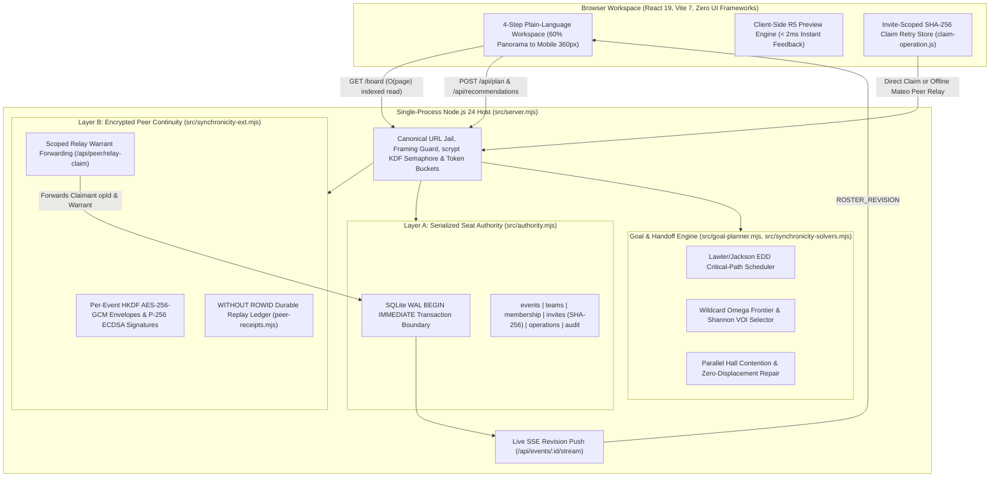

# Post Sheet: Ability and Purpose Crew Network (Hack4Hack PS1)

Post Sheet is a race-safe, goal-conditioned team formation engine built for Hack4Hack Crew Hiring Challenge 2026 (Problem Statement 1). Instead of treating team formation as a static directory of resumes, cities, and school badges, the system starts from what a crew is actually trying to build, verifies whether real human schedules and skills can deliver every task before the deadline, guarantees single-winner seat admission under 50-way burst traffic, and keeps teammates collaborating through signed encrypted peer relays when direct internet access drops.

---

## Table of Contents

1. [Why Standard Team Boards Break Down](#1-why-standard-team-boards-break-down)
2. [System Architecture and Two-Layer Network Design](#2-system-architecture-and-two-layer-network-design)
3. [System Stack and Engineering Rationale](#3-system-stack-and-engineering-rationale)
4. [Mathematical Formulation Under the Hood](#4-mathematical-formulation-under-the-hood)
5. [Visual Ergonomics and Cognitive Accessibility](#5-visual-ergonomics-and-cognitive-accessibility)
6. [Hack4Hack PS1 Requirements Crosswalk](#6-hack4hack-ps1-requirements-crosswalk)
7. [Quick Start: Local and Docker](#7-quick-start-local-and-docker)
8. [Running the Complete Verification and Load Suite](#8-running-the-complete-verification-and-load-suite)
9. [HTTP API Surface and Configuration Reference](#9-http-api-surface-and-configuration-reference)
10. [Repository Layout and Key Reports](#10-repository-layout-and-key-reports)
11. [Research References](#11-research-references)

---

## 1. Why Standard Team Boards Break Down

Most hackathon team finders copy job-board filters: pick a city, filter by college, check off `React`, `Node`, and `Postgres`, send invite codes, and mark the team "Full" the moment four names land on the roster. In real events, nominally full teams fail to ship for five structural reasons that static profile matching cannot see:

1. **The Full-Roster Illusion (Simultaneous Role Contention):** Suppose a project needs parallel backend and database work between 09:00 and 11:00 UTC. Builder A knows both backend and database; Builder B knows frontend. A standard skill-union check sees all three badges present and marks the team ready. In reality, Builder A has human capacity one and cannot staff two simultaneous critical-path roles at once (a classic Hall marriage deficit; Hall, 1935).
2. **Symmetric Timezone Filtering Throws Away Relay Teams:** Standard matchers score timezone compatibility by counting simultaneous waking overlap. Under that rule, a builder in Chicago (`UTC-6`) and a builder in Bengaluru (`UTC+5.5`) look incompatible because they share almost zero live hours. Yet if Chicago finishes the API right before Bengaluru wakes up to run integration, a directed asynchronous handoff finishes ahead of schedule without either person losing sleep.
3. **Resume Gatekeeping vs. Blind Trust:** Requiring portfolios upfront locks out capable self-taught builders, while ignoring skill evidence entirely hides single-point-of-failure risks. Treating unverified skills as explicit four-valued states lets a team proceed immediately whenever another teammate already covers the critical path, asking a verification question only when an unverified skill can actually make or break delivery.
4. **Mid-Event Dropouts Wreck Static Rosters:** Optimizing only initial team entry leaves crews stranded when a key builder drops out 12 hours before submission (Demirovic et al., 2018). Recovery has to respect existing teammates' commitments and isolate the smallest change that restores a working schedule.
5. **Read-Then-Write Seat Races Overfill Teams:** Standard web apps often check `SELECT COUNT(*) FROM members WHERE team_id = ?` in application code and then run `INSERT` in a second round-trip, or spread state across cache layers without a single serialization boundary. When 50 applicants click the final open seat at the same millisecond, multiple requests read `4 < 5` and overfill the roster, or double-book one person across two teams in the same event.

Post Sheet keeps the everyday user interface calm and plain (`1. Find teammates`, `2. Plan the work`, `3. Manage your team`, `4. Test the last spot`) while running exact transactional and scheduling invariants underneath.

---

## 2. System Architecture and Two-Layer Network Design

A central design principle in distributed databases is **invariant confluence** (Bailis et al., 2014): operations that commute without violating safety constraints (such as shared task notes or draft schedules) can proceed locally and merge without global locks, whereas operations governed by scarce global invariants (such as `team_size <= max_size` and one-team-per-person-per-event) fundamentally require serialized coordination.

Post Sheet separates those two responsibilities into **Layer A** and **Layer B**, and splits runtime traffic into **three non-blocking execution paths**:



### Three Separated Execution Paths
1. **Hot Board Read Path (`GET /api/events/:id/board`):** Executes a pure indexed SQLite projection (`LIMIT` / `OFFSET`) and streams live revision notifications over Server-Sent Events (`/stream`). It never invokes the constraint solver and sustains `p95 = 36.68 ms` across 100 concurrent clients on a 10,000-user, 2,000-team database.
2. **Bounded Planning and Recommendation Path (`POST /api/plan`, `POST /api/recommendations`):** Evaluates directed task DAGs, four-valued skill evidence, Hall contention repairs, and UTC baton-pass candidates under explicit node and witness caps (`maxNodes`, `maxWitnesses`). It proposes plans and explanations but can never grant a seat on its own.
3. **Serialized Authority Commit Path (`POST /api/teams`, `POST /api/invitations`, `POST /api/invitations/claim`, `POST /api/peer/relay-claim`, `POST /api/teams/leave`, `POST /api/teams/transfer`):** Runs short, deterministic `BEGIN IMMEDIATE` transactions in SQLite WAL. Every commit re-verifies server time, bearer identity, single-use invite hash validity, event-wide person uniqueness, team capacity, and `(event_id, actor_id, op_id, request_hash)` idempotency before writing the membership row and attributable audit entry atomically.

---

## 3. System Stack and Engineering Rationale

Hack4Hack permits any defensible stack. Rather than assembling an ORM, an external Redis lock service, a separate message broker, and a heavy component library (which multiply network hops, failure modes, and cold-start times on free-tier hosting), every layer here was chosen for strict determinism, inspectability, and zero external runtime services:

| Layer | Technology Choice | Why This Beats the Conventional Default for PS1 |
| --- | --- | --- |
| **Backend Runtime** | **Node.js 24 LTS** (Native ESM, `node:http`) | Zero framework middleware magic. Request framing, URL canonicalization, `16 KiB`/`32 KiB` body caps, prototype-pollution guards, and socket timeouts (`headersTimeout = 10s`, `requestTimeout = 15s`) sit directly at the perimeter in `src/server.mjs`. |
| **Authoritative Storage (Layer A)** | **Built-in `node:sqlite` (`DatabaseSync`)** in **WAL** mode with explicit `BEGIN IMMEDIATE` | Eliminates network round-trips between app and database and prevents the read-then-write race window common in async ORM pools. In SQLite WAL mode, 100 concurrent `/board` readers proceed in parallel without blocking, while `BEGIN IMMEDIATE` serializes seat mutations in microseconds on a single node with zero split-brain risk. |
| **Authentication and Cryptography (Layer B)** | **Built-in `node:crypto`** (`scrypt`, `hkdfSync`, `AES-256-GCM`, `ECDSA P-256`, `HMAC-SHA256`, `timingSafeEqual`) | Zero third-party JWT or crypto npm packages. Passwords hash asynchronously via `scrypt` (`N=16384, r=8, p=1`) behind a concurrency-4 semaphore so login floods cannot stall `/board`, with dummy KDF execution on unknown usernames to prevent timing enumeration. Peer notes are sealed at rest per event with RFC 5869 `HKDF-SHA256` derived `AES-256-GCM` keys and author-signed with `P-256` keys (`0` plaintext notes stored on disk). |
| **Offline Relay Authorization** | **Scoped HMAC Relay Warrants** (`aud: h4h-ps1-relay-warrant`) and **SHA-256 `opId`** | When a claimant loses WAN access, they do not hand their session token to a peer. Instead, a narrow 10-minute warrant bound to `{sub, eventId, teamId, opId, codeHash}` authorizes an uplinked peer (`relay-mateo`) to forward that exact claim once. Direct retry after reconnect returns `replayed: true` with zero duplicate rows. |
| **Live Updates** | **Server-Sent Events (SSE)** (`text/event-stream`) | Lighter and proxy-friendlier than bidirectional WebSockets for one-way roster invalidation, with automatic browser reconnect, `25s` keepalive heartbeats, and per-IP stream caps. |
| **Frontend Application** | **React 19** and **Vite 7** with custom CSS tokens (`web/src/style.css`) | Zero CSS/UI widget dependencies. Total production bundle builds in ~750 ms, honors strict `Content-Security-Policy: default-src 'self'` (zero external fonts, scripts, or CDNs), runs the R5 planner locally in under `2 ms` for instant preview, and adapts cleanly from `1440px` 3-column desktop panorama down to `360px` mobile screens. |
| **Independent Verification** | **Node Test Runner (`node:test`)** and **Python 3.12 (`sqlite3`)** | Alongside 111 Node integration, crypto, security, and solver tests, an independent Python process (`tests/sql-independent.py`) opens the post-race SQLite file directly to verify relational, capacity, uniqueness, and audit invariants without sharing a single line of JavaScript application code. |
| **Container and Cloud Packaging** | **Multi-stage `Dockerfile`** (`node:24-bookworm-slim`), **`render.yaml`**, **`docker-compose.hardened.yml`** | Pre-builds the React bundle and bakes the deterministic 10,000-user / 2,000-team seed at image build time. Runs as non-root `USER node` with `/app` chmodded read-only, dropped Linux capabilities (`cap_drop: [ALL]`), `no-new-privileges`, and `/health` readiness checks. |

---

## 4. Mathematical Formulation Under the Hood

To keep the workspace approachable under hackathon time pressure, mathematical notation was deliberately removed from UI buttons and status banners. The exact deterministic models implemented in `src/goal-planner.mjs` and `src/synchronicity-solvers.mjs` are documented below.

### 4.1 Arrangement Model and Non-Overlapping Human Capacity

For a project goal $g = (V, E, T_{\text{start}}, T_{\text{deadline}})$ with tasks $j \in V$, durations $d_j > 0$, precedence edges $(i, j) \in E$, handoff lags $\ell_{i,j} \ge 0$, and candidate builders $u \in U$ with availability intervals $W_u$ and consent flags $c_u \in \{0, 1\}$, an arrangement $a$ assigns each task $j$ to one consenting contributor $u_j$ over an execution interval $[s_j, f_j)$ where $f_j = s_j + d_j$.

Feasibility in world state $\omega$ requires every task to be covered within the contributor's merged availability windows without ever double-booking one person across two overlapping tasks:

$$\forall j \in V: \quad c_{u_j} = 1, \quad [s_j, f_j) \subseteq \bigcup_{w \in W_{u_j}} w, \quad f_j \le \min(T_{\text{deadline}}, T_j^{\max})$$

$$\forall (i, j) \in E: \quad s_j \ge f_i + \ell_{i,j}$$

$$\forall u \in U, \; \forall t \in [T_{\text{start}}, T_{\text{deadline}}): \quad \sum_{j \in V} \mathbf{1}[u_j = u] \cdot \mathbf{1}[t \in [s_j, f_j)] \le 1$$

### 4.2 Directed Critical-Path Slack and Lawler/Jackson EDD Scheduling

Naive greedy schedulers assign tasks in array order or by total slack alone, which fails when a short urgent task contends with a longer flexible task on the same specialist. `computeTaskScheduleMeta` runs a cycle-checked topological pass forward from $T_{\text{start}}$ and backward from $T_{\text{deadline}}$:

$$ES_j = \max\Big(T_{\text{start}}, \; \max_{(i,j) \in E} (EF_i + \ell_{i,j})\Big), \qquad EF_j = ES_j + d_j$$

$$LF_j = \min\Big(T_j^{\max}, \; \min_{(j,k) \in E} (LS_k - \ell_{j,k})\Big), \qquad LS_j = LF_j - d_j, \qquad \text{Slack}_j = LS_j - ES_j$$

Ready tasks are prioritized by **Earliest Due Date** ($LF_j$, breaking ties by $LS_j$ and task ID), extending Jackson's rule (Jackson, 1955) and Lawler's precedence-constrained sequencing rule (Lawler, 1973). When two ready tasks compete for a versatile contributor, `planGoal` orders candidates by lowest goal-skill versatility first (saving multi-skilled builders for bottleneck roles) and explores exact event-point start times (`candidateEventStarts`: window openings, dependency release times, and prior task completions) with visited-state memoization. Across 100 seeded tight-deadline random DAGs (`R6_EXP10`), this scheduler matches a clean-room exhaustive event-point oracle `100%` of the time.

### 4.3 Belnap Four-Valued Evidence and Wildcard Omega Question Suppression

Builder capability evidence is stored as an independent support/refutation pair $e(u, s) = (\text{support}, \text{refute}) \in \{0,1\}^2$ following Belnap's four-valued logic (Belnap, 1977):

- $(1, 0) \mapsto \text{supported}$ (verified work sample or confirmed capability)
- $(0, 1) \mapsto \text{refuted}$ (explicitly unavailable or ruled out)
- $(1, 1) \mapsto \text{conflicting}$ (contradictory claims; never silently promoted to confirmed)
- $(0, 0) \mapsto \text{unknown}$ (unverified self-report or omitted portfolio; never penalized as zero)

Let $\Omega_\sigma = \{0, 1\}^m$ ($m \le 12$, $|\Omega_\sigma| \le 4096$, with viable task-relevant unknowns prioritized first) be the set of unresolved `(person, skill)` wildcards. For each candidate witness $a$, its satisfaction region is $\text{Sat}_g(a) = \{\omega \in \Omega_\sigma : F_g(a, \omega) = 1\}$. `evaluateWildcardFrontier` strictly separates two quantifier regimes:

1. **Robust Sufficiency ($\exists a \, \forall \omega \in \Omega_\sigma : F_g(a, \omega) = 1$):** At least one unconditional arrangement succeeds regardless of how unknown skills resolve (`EXISTS_FORALL_ROBUST`). Our minimum-sufficient policy emits `ALREADY_SUFFICIENT` and asks **zero** verification questions.
2. **Action-Sensitive Contingency ($\forall \omega \in \Omega_\sigma \, \exists a$ or $0 < |\bigcup_a \text{Sat}_g(a)| < |\Omega_\sigma|$):** Feasibility depends on at least one unverified capability. Let $Y(\omega) = \mathbf{1}[\exists a : \omega \in \text{Sat}_g(a)]$ denote world solvability under a uniform prior over $\Omega_\sigma$. We rank each unresolved guard $X_k$ by Shannon mutual information (Shannon, 1948; Raiffa and Schlaifer, 1961):

$$I(Y; X_k) = H(Y) - \frac{1}{2} H(Y \mid X_k = 1) - \frac{1}{2} H(Y \mid X_k = 0)$$

where $H(p) = -p \log_2 p - (1 - p) \log_2 (1 - p)$, and surface only the single highest-gain question $k^* = \arg\max_k I(Y; X_k)$.

### 4.4 Parallel Hall Contention Diagnosis and Zero-Displacement Repair

When `planGoal` finds no feasible schedule, `diagnoseAndRepair` separates three distinct failure modes so the user gets an honest fix instead of a generic error:

- **Uncovered Skill (`MISSING_CAPABILITY_REPAIR`):** No consenting member holds a required task skill.
- **Sequential or Window Overrun (`SCHEDULE_HANDOFF_REPAIR`):** Skills exist, and tasks are sequential (one depends on the other), so no simultaneous capacity shortage exists; rather, contributor availability windows miss the precedence handoff or deadline.
- **Genuine Parallel Hall Deficit (`HALL_CAPACITY_CONTENTION_REPAIR`):** A subset of concurrently overlapping tasks $K \subseteq V$ (neither is an ancestor of the other, and their feasible intervals intersect) maps to a neighborhood of qualified consenting members $N(K)$ with $|N(K)| < |K|$. By Hall's Theorem (Hall, 1935), no 1-to-1 assignment exists. The solver isolates the overloaded contributor and ranks external candidates who restore feasibility with **zero displacement** of already committed teammates.

### 4.5 Merged Interval-Union Overlap and Directed UTC Baton-Pass Scoring

In `recommendComplementary`, overlapping or fragmented availability windows on existing members are first collapsed into disjoint canonical intervals via `mergeIntervals` so multi-member teams never double-count synchronous minutes. Each candidate $c$ is then evaluated on three explicit, inspectable signals rather than an opaque "AI match percentage":

1. **Newly Covered Critical Skills:** Required goal skills currently missing or bottlenecked on the roster.
2. **Synchronous Overlap Minutes:** Exact intersection length between $W_c$ and the merged roster availability union.
3. **Directed Asynchronous Baton-Pass Alignment:** Whether a dependency edge $(i, j) \in E$ allows an existing member to finish task $i$ at $f_i$ and hand off directly into candidate $c$'s waking window $s_j \in W_c$ within bounded handoff slack $0 \le s_j - (f_i + \ell_{i,j}) \le W_{\text{handoff}}$.

---

## 5. Visual Ergonomics and Cognitive Accessibility

Hackathon tools are typically used late at night under fatigue, or by builders with diverse visual and cognitive processing needs. The React interface (`web/src/`) applies peer-reviewed visual perception and cognitive accessibility findings rather than decorative dashboard tropes:

- **Opaque Reading Cores Over Translucent Glass Blur:** Feature-congestion research by Rosenholtz, Li, and Nakano (2007) demonstrates that background gradients bleeding behind dense text increase visual clutter and slow visual search. All reading cards (`.surface-card`, `.crew-card`) use `100%` opaque `#121820` surfaces (`~13.5:1` primary text contrast in Moonlight Dark, `~20.1:1` in High Contrast, `~17.8:1` in Moonlit Pearl light mode), restricting translucency strictly to floating header/popover chrome.
- **Zero Idle Peripheral Animation:** Gutwin, Cockburn, and Coveney (2017) showed that motion remains a potent involuntary attention-capture trigger far into peripheral vision. Our 24-hour UTC handoff horizon (`SolarBatonHorizon.jsx`) renders a single static canvas frame at rest (`0` idle `requestAnimationFrame` loops) and animates only a bounded `850 ms` arc when the user actively tests a handoff, freezing completely when `Motion: Static Off` is selected.
- **Bounded Tactile Relief with Flat Fallback:** Following depth-from-shading cues (Loop, 1995) tempered by Li and Liu's (2024) finding that stacking excessive shadow and color variables degrades icon search, operable controls carry a subtle top-left rim and shallow contact shadow while passive containers stay recessed. Users can switch between `CRR Active` and `Flat Baseline` (`data-crr="flat"`), three color palettes, and four typography scales (`60% Panorama` `44fr/28fr/28fr` command center up to `115%` large print) from the `Display & A11y` menu.
- **Semantic Honesty and Plain Language:** Guided by neurodivergent eye-tracking and easy-to-read interface studies (Eraslan et al., 2021; W3C COGA), partial `2/3` task coverage renders amber (`Plan incomplete: 2 of 3 tasks covered`), local previews explicitly say `Preview only - not joined yet`, offline saves say `Saved on this device`, and green `Confirmed by server` badges appear exclusively after an authoritative SQLite `BEGIN IMMEDIATE` commit.

---

## 6. Hack4Hack PS1 Requirements Crosswalk

Every acceptance criterion in the Hack4Hack PS1 brief is implemented, tested in CI, and directly verifiable in the UI and CLI:

| PS1 Requirement | Implementation Coordinate | Automated Proof & Measured Result |
| --- | --- | --- |
| **Bounded team size (`maxSize`)** | `src/authority.mjs` (`claim`, `BEGIN IMMEDIATE`) | `API17`, `ADV01`, `sql-independent.py`: `0` oversize teams across 2,000 seeded teams and 50-way bursts |
| **One team per person per event** | `UNIQUE(event_id, user_id)` in `membership` paired with transactional check in `src/authority.mjs` | `API05`, `API18`, `ADV03` (concurrent cross-team double-book blocked `100%`) |
| **Single-use invitations with server-enforced expiry** | `invites` table stores `SHA-256(code)` (`0` plaintext codes); server clock checks `expires_at` | `API09..16`, `API26`, `ADV04` (client-forged clock rejected with `410 INVITE_EXPIRED`) |
| **Leader permissions, explicit transfer, and automatic succession** | `invite` restricted to leader; `transferLeader` & `leave` promote earliest `joined_at` member | `API10`, `API21`, `R5_05..12`, R10 `5 -> 0` cascading departure audit (`0` orphan leaders) |
| **Auto-deletion when final member leaves** | `leave` deletes empty team row atomically inside `BEGIN IMMEDIATE` | `API22` (`NO_TEAM` confirmed immediately after final member departure) |
| **50 concurrent claimants on 1 final seat -> 1 winner** | `POST /api/invitations/claim` & `/api/demo/race-50` (`src/authority.mjs`, `src/server.mjs`) | `ADV01` & `SEC05`: 50 parallel HTTP requests -> `1` HTTP `200` winner, `49` HTTP `409`, `76 ms` |
| **Idempotent retries across network drops and peer relays** | `operations` ledger `(event_id, actor_id, op_id, request_hash)` and `web/src/claim-operation.js` | `API13..14`, `ADV02` (20 concurrent duplicates -> 1 commit, 19 replays), `UI01..06`, `SEC04` |
| **Live board updates** | SSE `GET /api/events/:id/stream` (`ROSTER_REVISION` push on commit) | `API29` (`tests/sse.test.mjs`) and live Column 3 indicator in React workspace |
| **Authentication, security hardening, and attributable audit log** | `scrypt` auth, HMAC tokens, scoped relay warrants, static path jail, `audit` table | `API02..04`, `API19..20`, `SEC01..12` (`12/12` exploit & wire-traversal suites PASS) |
| **Explained complementary-skill and timezone recommendations** | `recommendComplementary` (`src/synchronicity-solvers.mjs`) and `POST /api/recommendations` | `R5_01..04`, `R6_EXP01..14` (synchronous overlap and directed UTC baton-pass explanations) |
| **At least 20 API checks in GitHub Actions** | `.github/workflows/ci.yml` | **170 automated assertions** (`59` gate checks and `111` Node tests) alongside `5` load-gate checks in CI |
| **10,000-user / 2,000-team seed & `/board` `p95 < 200 ms` at 100 clients** | `src/seed.mjs` and `scripts/exact-p95-bench.mjs` | Seeded in `13.4 s`; `100`-client `/board` **`p95 = 36.68 ms`** (`16,983` reqs in `5s`, `0` errors) |
| **Mobile and keyboard-accessible React flow and live deployment** | `web/src/*` (`360px` responsive layout, `Ctrl+K`, `Alt+1..4`) with `Dockerfile` and `render.yaml` | Verified at `1440x900` and `360x800` (`0` horizontal overflow) with 1-click Render Docker blueprint |

---

## 7. Quick Start: Local and Docker

### Prerequisites
- **Node.js >= 24.0.0** (uses built-in `node:sqlite` and `node:crypto`; zero native C++ addon compilation required)
- **Python >= 3.10** (only required when running `tests/sql-independent.py` in the verification gate suite)

### Option A: Local Bare-Metal Run (Seeds 10,000 Users and Starts on Port 8788)

```bash
# 1. Install frontend build tooling and compile the production React bundle
npm ci --prefix web
npm run build --prefix web

# 2. Seed 10,000 users across 2,000 teams and start the server on http://127.0.0.1:8788
bash scripts/start-local.sh
```

Open `http://127.0.0.1:8788` in your browser.
- Use **Acting as: Aurora** in the top bar to switch between demo personas (`leader-aurora`, `builder-kai`, `builder-priya`, `relay-mateo`) or register/sign in with a `scrypt`-backed account.
- Use **Display** in the top bar to switch color themes (`Moonlight Dark`, `High Contrast`, `Moonlit Pearl`), text scale (`60%` Panorama through `100%` Standard), or motion mode.
- Click **Guide [`?` or `F1`]** on the upper shortcut bar for the purpose-first overview and keyboard map, or open **4. Test the last spot** -> **5-Minute Walkthrough** for an interactive tour across all four steps.

### Option B: Hardened Non-Root Docker Container

```bash
docker compose -f docker-compose.hardened.yml up --build
```

This builds the React client and 10,000-user SQLite seed inside a builder stage, then launches the runtime container on `http://127.0.0.1:8788` as `USER node` with a read-only root filesystem, `cap_drop: [ALL]`, `no-new-privileges`, `pids_limit: 128`, and a `512m` memory ceiling.

---

## 8. Running the Complete Verification and Load Suite

All verification suites run locally without external cloud accounts or network dependencies:

```bash
# 1. Kernel Gate Suite (59 assertions):
#    - Baseline: 28 HTTP API invariants, 14 Goal Planner invariants, and 1 SSE push check (43)
#    - Adversarial: 50-way final-seat HTTP race, 20-way duplicate storm, cross-team race, forged clock (4)
#    - Independent Oracle: 12 direct Python sqlite3 relational & audit queries (12)
bash scripts/run-gates.sh scripts/baseline.sh scripts/adversarial.sh scripts/independent.sh

# 2. Complete Node Test Suite (117 subtests across 10 test files):
#    Covers Layer-B AES-256-GCM / P-256 envelopes, WITHOUT ROWID durable receipts,
#    loopback HTTP peer relay, browser SHA-256 retry storage, R5/R12/R15 solver & matcher labs,
#    and SEC01..SEC12 security & wire-level path-traversal hardening
node --test tests/*.test.mjs

# 3. Deterministic 10,000-User / 2,000-Team Seed & 100-Concurrent-Client p95 Benchmark:
node src/seed.mjs /tmp/bench-seed.sqlite
PS1_AUTH_SECRET="local-bench-32-byte-secret-key-material-01" \
PS1_SQLITE_PATH="/tmp/bench-seed.sqlite" \
PS1_BIND="127.0.0.1" \
PS1_PORT="8799" \
node src/server.mjs &
SRV_PID=$!
sleep 1
node scripts/exact-p95-bench.mjs "http://127.0.0.1:8799/api/events/seed-event/board?limit=100" 100 5000
kill "$SRV_PID"
```

---

## 9. HTTP API Surface and Configuration Reference

### Primary Endpoints (`src/server.mjs`)

| Method & Route | Auth | Purpose |
| --- | --- | --- |
| `GET /health` (`HEAD /health`) | Public | Container liveness probe (`200 {"status":"up"}`) |
| `POST /api/auth/register` / `POST /api/auth/login` | Public | Async `scrypt` account registration and login (`Bearer` token issuance) |
| `POST /api/auth/logout` | Bearer | Revokes active token in durable `ps1_revoked_tokens` table |
| `POST /api/auth/demo` | Public (when `PS1_DEMO_AUTH=1`) | Issues isolated demo persona token (`DEMO_PERSONA_RE` enforced; blocks impersonation of registered accounts) |
| `POST /api/auth/relay-warrant` | Bearer | Mints narrow 10-minute `h4h-ps1-relay-warrant` bound to `{sub, eventId, teamId, opId, codeHash}` |
| `GET /api/events/:ev/board` | Public | Paginated indexed team projection (`?limit=100&offset=0&meta=1`) |
| `GET /api/events/:ev/stream` | Public | Live SSE stream emitting `ROSTER_REVISION` frames after committed mutations (`25s` keepalive) |
| `GET /api/events/:ev/teams/:tid` | Public | Full roster and leader state for a specific team |
| `GET /api/events/:ev/audit` | Bearer | Chronological tail (`LIMIT 100`) of attributable event audit records |
| `POST /api/events` | Bearer | Creates or configures an event capacity boundary (`{ eventId, maxSize }`) |
| `POST /api/teams` | Bearer | Creates a team with the caller as initial leader (`{ eventId, teamId }`; `409 ONE_TEAM_PER_EVENT` / `TEAM_EXISTS`) |
| `POST /api/invitations` | Bearer (Leader) | Issues a single-use invite (`{ eventId, teamId, expiresAt }`); stores only `SHA-256(code)` |
| `POST /api/invitations/claim` | Bearer | Atomically claims an open seat (`{ eventId, teamId, code, opId }`) with idempotent replay (`409 TEAM_FULL` / `INVITE_INVALID_OR_USED`, `410 INVITE_EXPIRED`) |
| `POST /api/teams/leave` | Bearer (Member) | Withdraws caller (`{ eventId, teamId }`), promotes earliest teammate on leader exit, or auto-deletes empty team |
| `POST /api/teams/transfer` | Bearer (Leader) | Atomically transfers leadership (`{ eventId, teamId, newLeaderId }`) to an existing team member |
| `POST /api/plan` | Bearer | Runs `planGoal`, `evaluateWildcardFrontier`, and `diagnoseAndRepair` on a goal DAG and candidate pool (`{ goal, people, maxNodes }`) |
| `POST /api/recommendations` | Bearer | Ranks complementary builders across missing skills, interval-union overlap, and directed UTC baton passes (`{ goal, teamPeople, candidates }`) |
| `POST /api/peer/notes` & `GET /api/peer/notes?eventId=:ev` | Bearer | Seals (`AES-256-GCM` with `P-256` signature) and verifies event collaboration notes (`0` plaintext stored in SQLite) |
| `POST /api/peer/glue` | Bearer | Checks concurrent peer schedule drafts via `contextGlueOrExplain` (`<= 128` records) |
| `POST /api/peer/relay-claim` | Bearer (Peer Relay) | Submits a disconnected claimant's warrant-bound seat claim through a distinct uplinked peer (`403 SELF_RELAY_FORBIDDEN` on self-relay) |
| `POST /api/demo/race-50` | Bearer (when `PS1_DEMO_AUTH=1`) | Runs an isolated 50-claimant final-seat burst on the live SQLite database (`10/min` rate bucket) and returns invariant telemetry |

### Environment Variables

| Variable | Default | Description |
| --- | --- | --- |
| `PS1_AUTH_SECRET` | *(Required, >= 32 bytes)* | Master secret for `HMAC-SHA256` session tokens and per-event `HKDF-SHA256` key derivation |
| `PS1_PORT` / `PORT` | `8788` | TCP listen port (`Dockerfile` honors cloud-injected `PORT` automatically) |
| `PS1_BIND` | `127.0.0.1` (`0.0.0.0` in Docker) | Network interface bind address |
| `PS1_SQLITE_PATH` | `./h4h-ps1.sqlite` | Path to SQLite WAL database file (or `:memory:` in unit tests) |
| `PS1_DEMO_AUTH` | `1` | Enables isolated judge demo personas and `/api/demo/race-50`; set `0` for strict account-only mode |
| `PS1_TRUST_PROXY` | `0` (`1` in Docker/Render) | Enables validated `cf-connecting-ip` / `x-forwarded-for` parsing and `Strict-Transport-Security` behind TLS proxies |

---

## 10. Repository Layout and Key Reports

- [`DESIGN.md`](./DESIGN.md): Concise one-page architecture, mathematical summary, and single-writer WAL trade-off analysis.
- [`LOAD_REPORT.md`](./LOAD_REPORT.md): Full 10,000-user seed, 100-client `/board` latency distribution, 50-way race telemetry, and reproduction commands.
- [`SECURITY.md`](./SECURITY.md): Threat model, cryptographic at-rest sealing, non-blocking `scrypt` KDF, container sandboxing, and wire-level traversal defenses (`SEC01..SEC12`).
- [`PREEXISTING_WORK.md`](./PREEXISTING_WORK.md): Attribution of prior Post Sheet / Synchronicity concepts vs. clean-room Hack4Hack PS1 implementation, ownership notice, and AI collaboration disclosure.
- [`docs/ENGINE_SOLVER_ADVERSARIAL_REVIEW.md`](./docs/ENGINE_SOLVER_ADVERSARIAL_REVIEW.md): Formal adversarial verification of scheduler completeness, Wildcard Omega frontiers, and parallel Hall contention (`R6_EXP01..14`).
- [`docs/PSS-H4H-CRR-01.R1-SUPPLEMENT.md`](./docs/PSS-H4H-CRR-01.R1-SUPPLEMENT.md): Visual perception, contrast tokens, and cognitive ergonomics engineering packet.
- [`docs/DECISION_AND_EXPERIMENT_LEDGER.md`](./docs/DECISION_AND_EXPERIMENT_LEDGER.md): Chronological engineering ledger preserving accepted, rejected-by-test, and superseded design experiments (`LED-01..LED-21`).
- [`SOURCE_MANIFEST.json`](./SOURCE_MANIFEST.json): SHA-256 integrity manifest covering every tracked file in the submission repository.

---

## 11. Research References

1. **Bailis, P., Fekete, A., Franklin, M. J., Ghodsi, A., Hellerstein, J. M., & Stoica, I. (2014).** *Coordination Avoidance in Database Systems.* Proceedings of the VLDB Endowment, 8(3), 185-196. (Grounds the split between coordination-free Layer-B collaboration and serialized Layer-A seat admission.)
2. **Hall, P. (1935).** *On Representatives of Subsets.* Journal of the London Mathematical Society, 10(1), 26-30. (Grounds simultaneous role-capacity deficit detection when skill unions mask one-person bottlenecks.)
3. **Jackson, J. R. (1955).** *Scheduling a Production Line to Minimize Maximum Tardiness.* Management Science Research Project Report 43, UCLA; and **Lawler, E. L. (1973).** *Optimal Sequencing of a Single Machine Subject to Precedence Constraints.* Management Science, 19(5), 544-546. (Grounds backward latest-finish Earliest Due Date task ordering across dependency DAGs.)
4. **Belnap, N. D. (1977).** *A Useful Four-Valued Logic.* In *Modern Uses of Multiple-Valued Logic* (pp. 5-37), D. Reidel. (Grounds independent `{support, refute}` capability states so missing portfolios are not scored as negative ability.)
5. **Shannon, C. E. (1948).** *A Mathematical Theory of Communication.* Bell System Technical Journal, 27(3), 379-423; and **Raiffa, H., & Schlaifer, R. (1961).** *Applied Statistical Decision Theory.* Harvard Business School. (Grounds expected information gain question selection over unresolved Wildcard Omega worlds.)
6. **Demirovic, E., Schwind, N., Okimoto, T., & Inoue, K. (2018).** *Recoverable Team Formation: Building Teams Flexible to Change.* Proceedings of the 17th International Conference on Autonomous Agents and MultiAgent Systems (AAMAS 2018), 750-758. (Grounds zero-displacement minimum-repair planning under member withdrawal.)
7. **Rosenholtz, R., Li, Y., & Nakano, L. (2007).** *Measuring Visual Clutter.* Journal of Vision, 7(2):17, 1-22. (Grounds `100%` opaque `#121820` reading surfaces and restrained inner borders over translucent backdrop-blur cards.)
8. **Gutwin, C., Cockburn, A., & Coveney, A. (2017).** *Peripheral Popout: The Influence of Visual Angle and Stimulus Intensity on Popout Effects.* Proceedings of ACM CHI 2017, 208-219. (Grounds zero idle animation frames in the 24-hour UTC horizon bar.)
9. **Li, M., & Liu, Y. (2024).** *Effects of Visual Variables on Map Icon Search Performance.* Cartography and Geographic Information Science; and **Loop, S. L. (1995).** *Depth-from-Shading as a Visual Cue in Graphical User Interfaces.* (Grounds bounded operable contact shadows paired with an instant flat-mode toggle.)
10. **Eraslan, S., Yesilada, Y., Yaneva, V., & Harper, S. (2021).** *Web Page Complexity and Eye-Tracking Scanpaths*; alongside **W3C Cognitive Accessibility Guidance (COGA).** (Grounds plain-language 4-step navigation and persistent user-controlled density/contrast settings.)
