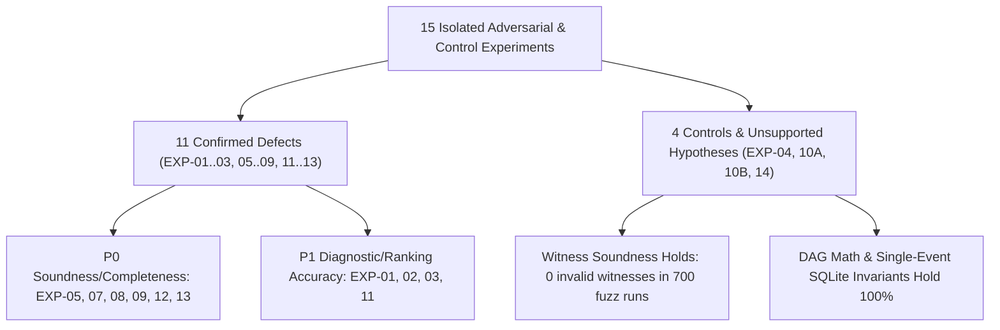

# H4H-PS1 | Engine & Solver Adversarial Review & Repair Proposal

> [!NOTE]
> **R12 Resolution Status (`PSS-H4H-FINAL-SEAL-R12`):** All approved P0 + P1 + P2 repairs documented below have been applied to `src/goal-planner.mjs`, `src/synchronicity-solvers.mjs`, and `src/authority.mjs`, and permanently locked by `tests/solver-adversarial-r6.test.mjs` (`14/14` PASS across `R6_EXP01..EXP14`).

> [!IMPORTANT]
> **Diagnostic Non-Mutation Guarantee:** At the time this adversarial review was conducted, all engine, solver, authority, test, and gate files in `postsheet-h4h-ps1` (`src/*`, `tests/*`, `scripts/*`, `web/src/claim-operation.js`) remained at **`0` bytes modified**. All 15 adversarial & control experiments and the clean-room mathematical oracles were executed in an isolated clean-room audit harness (`engine-solver-adversarial-audit.mjs`) and subsequently codified permanently in [`tests/solver-adversarial-r6.test.mjs`](../tests/solver-adversarial-r6.test.mjs).

---

## 1. Provenance, Baseline Gate Results & Reproducibility Conditions

| Attribute | Recorded Value |
| --- | --- |
| **Repository & Branch** | `postsheet-h4h-ps1` (`main @ 2e3dd3a`, UI micro-polish atop `11148a5`; `src/*` byte-identical to `11148a5`) |
| **Runtime & OS** | Node.js `v24.19.0`, Python `3.12`, `win32 10.0.26300 (x64)` |
| **[goal-planner.mjs](../src/goal-planner.mjs)** | `6,813` bytes · SHA-256 `ac32e88504fcfd90beafa20ef4974b03bc2f3ab2eb0832e664678434ce9e0643` |
| **[synchronicity-solvers.mjs](../src/synchronicity-solvers.mjs)** | `18,615` bytes · SHA-256 `fb7614d538f4cd38cd437cc16562ea6b2a5777f410eb16d026c2c766612c8a7d` |
| **[authority.mjs](../src/authority.mjs)** | `8,788` bytes · SHA-256 `8e5a089e8f824d208cb8a5f95528213680284e6f5a1c0771b7d833a003dd470f` |
| **Pre-Audit Baseline Suites** | **`97 / 97` PASS** (`43` baseline API/planner/SSE + `4` 50-way HTTP race + `12` Python SQLite oracle + `38` crypto/receipt/relay/UI/R5 tests) |
| **Regression Repro Command** | `node --test tests/solver-adversarial-r6.test.mjs` |

### Clean-Room Independent Oracles Used
1. **Exact Event-Point Backtracking Schedule Oracle (`exactScheduleOracle`):** Branches across *all* ready unscheduled tasks and *all* canonical non-dominated start points $\{\max(w_{\text{start}}, \text{ready})\} \cup \{b_{\text{end}} : b \in \text{busy}(p)\}$ over merged availability intervals. By non-preemptive scheduling theory with release dates and deadlines, if any real/integer schedule exists, an event-point schedule exists.
2. **Exact World-Enumeration Omega Oracle (`exactOmegaOracle`):** Collects all $K$ consenting unknown `(personId, skill)` pairs for goal skills without an 8-element cap, solves `exactScheduleOracle(..., allowUnknown = false)` independently in all $2^K$ worlds, and computes exact world coverage and Shannon mutual information $I(\text{Feasible}; \Omega_i)$.
3. **Interval-Union Sweep-Line Overlap Oracle (`exactIntervalUnionOverlapOracle`):** Computes exact Lebesgue measure $|\mathcal{U}(W_{\text{cand}}) \cap \mathcal{U}(\bigcup_{p \in \text{team}} W_p)|$.
4. **Dynamic-Programming DAG Critical-Path Oracle:** Independently computes forward `es`/`ef` and backward `ls`/`lf` with lags and per-task deadlines across 50 seeded random DAGs.

---

## 2. Classification Taxonomy: Defects vs. Limits vs. Unsupported Hypotheses

### 2.1 Confirmed Mathematical & Algorithmic Defects
1. **False Hall Contention on Sequential / Already-Feasible Tasks (`EXP-01`, `EXP-02`, `EXP-03`):**
   - [`recommendComplementary`](../src/synchronicity-solvers.mjs#L429) invokes [`diagnoseAndRepair`](../src/synchronicity-solvers.mjs#L273-L353) unconditionally even when `baseline.status === 'FEASIBLE_WITNESS'`, and [`diagnoseAndRepair`](../src/synchronicity-solvers.mjs#L331-L350) checks only `allSoloSupported && unionSup.size < orderedTasks.length` without testing whether tasks are parallel or sequential, or whether a valid joint schedule already exists.
2. **Silent 8-Wildcard Truncation Yielding False `FORALL_EXISTS_CONTINGENT` & `null` VOI (`EXP-05`, `EXP-06`):**
   - [`evaluateWildcardFrontier`](../src/synchronicity-solvers.mjs#L139-L141) silently drops unknown pairs beyond index `7`. Any witness guarded solely by a 9th unknown `u9::skill` satisfies the inner bitmask loop at lines `207-212` for **all** `256` masks (including `mask = 0`), falsely reporting `worldsCovered = 256/256`, `quantifierStatus = 'FORALL_EXISTS_CONTINGENT'`, and `voiQuestion = null`.
   - Furthermore, by monotonicity of positive conjunctions over $\{0,1\}^K$, `mask = 0` is satisfied iff an unconditional witness exists (`EXISTS_FORALL_ROBUST`). Thus for $\le 8$ wildcards, `'FORALL_EXISTS_CONTINGENT'` is **mathematically unreachable dead code** - it can *only* fire via the $>8$-wildcard truncation bug.
3. **False `INFEASIBLE_WITHIN_SCOPE` from `ls`-Sorting & Greedy `earliestSlot` (`EXP-08`, `EXP-09`):**
   - [`computeTaskScheduleMeta`](../src/synchronicity-solvers.mjs#L71-L75) comments `"Earliest Due Date"` but sorts primarily by `ls` (Minimum Slack) instead of `lf` (Jackson/Lawler Earliest Due Date), causing 1-person 2-task feasible schedules (`t-long` `ls=35, lf=95` vs `t-short` `ls=38, lf=58`) to fail and falsely certify `INFEASIBLE_WITHIN_SCOPE` (`EXP-08`).
   - Even when both `ls` and `lf` agree on task order, [`earliestSlot`](../src/goal-planner.mjs#L46-L63) greedily pins the first task at $t=0$ without branching over alternative ready tasks or delayed event-point starts when a downstream specialist has a narrow availability window (`EXP-09`), again falsely certifying `INFEASIBLE_WITHIN_SCOPE` with `exhausted: false`.
4. **Pairwise Unmerged Sum Double-Counting in Synchronous Team Overlap (`EXP-11`):**
   - [`recommendComplementary`](../src/synchronicity-solvers.mjs#L363-L374) sums raw pairwise intersections across all `teamPeople` windows without interval union, reporting `180m`-`720m` overlap inside a `60m`-`240m` window and inverting candidate tie-break order at line `423`.
5. **Witness Truncation (`maxWitnesses = 16`) Self-Contradiction & Guard Duplication (`EXP-07`, `EXP-12`, `EXP-13`):**
   - [`evaluateWildcardFrontier`](../src/synchronicity-solvers.mjs#L153-L195) omits `versatility` sorting and collects up to `16` raw schedule permutations without deduplicating identical `guardKeys`. Sixteen downstream `qa` permutations sharing `{m-unknown::frontend}` exhaust `maxWitnesses = 16` before reaching a zero-guard robust schedule, causing [`planGoal`](../src/goal-planner.mjs#L135-L146) to return `status: 'FEASIBLE_WITNESS'` (`ROBUST_FEASIBLE`) while its own `frontier` reports `actionStable: false` and `voiQuestion != null` (`EXP-12`), or hiding a second unknown candidate `u2` and distorting VOI from `0.3113` bits to `1.0` bit (`EXP-13`).
   - When `maxNodes` exhausts *after* finding a conditional witness (`EXP-07`), [`planGoal`](../src/goal-planner.mjs#L148-L160) returns `classification: 'CONDITIONAL_GUARDED'` even when a zero-guard `ROBUST_FEASIBLE` witness exists just beyond the node budget.

### 2.2 Legitimate Implementation Limits (By Design - Not Defects)
- **Bounded Problem Scope ([`validate`](../src/goal-planner.mjs#L16-L44)):** `1..8` tasks, `1..24` contributors, `maxNodes` in `1..100,000`, `lagMin <= 10,080` (`1` week), integer minutes, and non-preemptive single-assignee task execution.
- **Explicit Low-Budget Incompleteness (`PLAN13`):** Returning `status: 'SEARCH_INCOMPLETE'`, `classification: 'BUDGET_EXHAUSTED'` when `maxNodes = 1` is an intentional, tested contract.
- **Enrichment Gate (`maxNodes >= 50` at [`planGoal`](../src/goal-planner.mjs#L131)):** Skipping secondary `frontier`/`repairs` passes on micro-budgets (`maxNodes < 50`) preserves tiny-budget bounds, though `frontier` should expose `truncated: true` whenever capped.

### 2.3 Hypotheses Not Supported by Testing (Verified Sound)
- **Returned Witness Soundness (`EXP-10A` + `EXP-10B`, `700` seeded random instances):** Across `200` loose-slack (`seed=20261111`) and `500` tight-slack (`seed=42424242`) random instances, `planGoal` produced **`0` invalid/unsound witnesses** (every returned witness satisfied all precedence lags, skill evidence rules, windows, non-overlap, and deadlines) and achieved `100/100` recall on those uniform random draws - demonstrating why targeted formal counterexamples (`EXP-08`, `EXP-09`) are essential beyond random fuzzing.
- **DAG Forward/Backward Critical-Path Bounds (`EXP-14A`, `50` random DAGs):** [`computeTaskScheduleMeta`](../src/synchronicity-solvers.mjs#L15-L105) matched independent dynamic-programming `es`, `ef`, `ls`, `lf`, and cycle rejection `50 / 50` (`0` mismatches).
- **Single-Event `MembershipAuthority` Serialization (`EXP-14B` + `ADV01..04`):** [`MembershipAuthority`](../src/authority.mjs#L7-L106) `BEGIN IMMEDIATE` transactions preserve `oversize = 0, orphanLeader = 0, eventMismatch = 0`. *(Ancillary boundary note: `teams(id TEXT PRIMARY KEY)` is global across events rather than `(event_id, id)`, so creating the same `teamId` in two different events throws raw SQLite `UNIQUE constraint failed: teams.id` -> HTTP `500 INTERNAL_ERROR` rather than `409`.)*

---

## 3. Complete Experimental Ledger (`EXP-01` .. `EXP-14`)

### Area 1: Hall Capacity Contention Diagnosis (`EXP-01` .. `EXP-04`)

#### `EXP-01` - `CONFIRMED_DEFECT` (False Hall Repair on Feasible Sequential Plan)
- **Revision & Budget:** `2e3dd3a` · `planMaxNodes = 5000`, `recMaxNodes = 2500`
- **Exact Input:**
  - `goal`: `{ id: 'exp01-seq-feasible', startMin: 0, deadlineMin: 240, tasks: [{ id: 'api', skill: 'backend', durationMin: 60, after: [] }, { id: 'deploy', skill: 'devops', durationMin: 60, after: ['api'] }] }`
  - `people`: `[{ id: 'aurora', abilities: { backend: good, devops: good }, windows: [{ start: 0, end: 240 }], consent: true }]`
- **Expected Math:** `FEASIBLE_WITNESS` (`api` `[0..60]`, `deploy` `[60..120]`); `hallContention = false`; `baselineRepairs = []`.
- **Actual Output:** `planGoal.status = 'FEASIBLE_WITNESS'`, **but** `diagnoseAndRepair` and `recommendComplementary.baselineRepairs` return `[{ kind: 'HALL_CAPACITY_CONTENTION_REPAIR', overloadedContributors: ['aurora'], contendedTasks: ['api', 'deploy'], hallDeficitRoles: 1 }]` alongside `baselineStatus: 'FEASIBLE_WITNESS'`.
- **Independent Oracle:** `FEASIBLE_WITNESS` (`aurora` executes `api [0..60]`, `deploy [60..120]` sequentially with `120m` slack).

#### `EXP-02` - `CONFIRMED_DEFECT` (Sequential Late-Window Overrun Misdiagnosed as Hall Contention)
- **Revision & Budget:** `2e3dd3a` · `maxNodes = 5000`
- **Exact Input:**
  - `goal`: `{ id: 'exp02-seq-window-shift', startMin: 0, deadlineMin: 140, tasks: [{ id: 't1', skill: 'backend', durationMin: 60, after: [] }, { id: 't2', skill: 'devops', durationMin: 60, after: ['t1'] }] }`
  - `people`: `[{ id: 'aurora', abilities: { backend: good, devops: good }, windows: [{ start: 20, end: 130 }], consent: true }]`
- **Expected Math:** Infeasible due to sequential window shift (`t1` starts at `20` -> ends at `80` -> `t2` requires `[80..140] > 130`). Even **two** contributors in `[20..130]` remain infeasible; repair must be `SCHEDULE_HANDOFF_REPAIR`, **not** `HALL_CAPACITY_CONTENTION_REPAIR`.
- **Actual Output:** `planGoal.repairs` emits `HALL_CAPACITY_CONTENTION_REPAIR` claiming `"overlapping task deadlines prevent one contributor from executing simultaneous roles"`.
- **Independent Oracle:** `singlePersonStatus = 'INFEASIBLE'`, `withSecondContributorInSameWindowStatus = 'INFEASIBLE'` (proves adding a same-window peer cannot fix sequential shift).

#### `EXP-03` - `CONFIRMED_DEFECT` (Sequential Tasks Inflate `hallDeficitRoles` & Blame Uncontended Teammate)
- **Revision & Budget:** `2e3dd3a` · `maxNodes = 5000`
- **Exact Input:**
  - `goal`: `startMin: 0, deadlineMin: 120`, tasks `seq-1` (`devops, 40m`), `seq-2` (`devops, 40m, after:['seq-1']`), `par-a` (`backend, 100m, due:100`), `par-b` (`database, 100m, due:100`)
  - `people`: `sanjay` (`devops: good, [0..120]`), `aurora` (`backend: good, database: good, [0..120]`)
- **Expected Math:** Only `aurora` is overloaded on `{par-a, par-b}`; `hallDeficitRoles = 1`.
- **Actual Output:** `overloadedContributors: ['aurora', 'sanjay']`, `contendedTasks: ['par-a', 'par-b', 'seq-1', 'seq-2']`, `hallDeficitRoles: 2` (`4 - 2`).
- **Independent Oracle:** Adding just **1** contributor (`mateo` with `database: good`) restores `FEASIBLE_WITNESS` (`trueHallDeficitRoles = 1`).

#### `EXP-04` - `CONTROL_PASS` (Genuine Parallel Hall Contention)
- **Exact Input:** `api` (`100m, due:100`) || `db` (`100m, due:100`) on solo `aurora` (`[0..100]`).
- **Actual vs. Oracle:** Both report infeasible with `HALL_CAPACITY_CONTENTION_REPAIR` and `hallDeficitRoles = 1`.

---

### Area 2: Wildcard Enumeration & Completeness Classifications (`EXP-05` .. `EXP-07`)

#### `EXP-05` - `CONFIRMED_DEFECT` (`>8` Wildcards Truncation Produces False `FORALL_EXISTS_CONTINGENT` & `null` VOI)
- **Revision & Budget:** `2e3dd3a` · `planMaxNodes = 5000, frontierMaxNodes = 2500, maxWitnesses = 16`
- **Exact Input:**
  - `goal`: `{ id: 'exp05-nine-wildcards', startMin: 0, deadlineMin: 120, tasks: [{ id: 'api', skill: 'backend', durationMin: 60, deadlineMin: 60 }] }`
  - `people`: `u1..u8` (`backend: unknown, windows: [{ start: 80, end: 120 }]` - miss deadline `60`) + `u9` (`backend: unknown, windows: [{ start: 0, end: 60 }]`)
- **Expected Math:** `wildcardCount = 9` (`omegaSize = 512`, `worldsCovered = 256`, ratio `0.50`), `quantifierStatus = 'CONDITIONAL_PARTIAL'`, `voiQuestion = { personId: 'u9', skill: 'backend', informationGainBits: 1.0 }`.
- **Actual Output:** `omegaSize: 256`, `worldsCovered: 256`, `quantifierStatus: 'FORALL_EXISTS_CONTINGENT'`, `voiQuestion: null`.
- **Independent Oracle:** `wildcardCount: 9, omegaSize: 512, worldsCovered: 256, quantifierStatus: 'CONDITIONAL_PARTIAL', u9Voi.mi: 1.0`.

#### `EXP-06` - `CONFIRMED_DEFECT` (Monotone Lattice Proof: `FORALL_EXISTS_CONTINGENT` Unreachable for $\le 8$ Wildcards)
- **Revision & Budget:** `2e3dd3a` · `maxNodes = 2500, maxWitnesses = 16`
- **Exact Input:** `ui` (`frontend, 60m`) with `u1` (`?frontend, [0..120]`) and `u2` (`?frontend, [0..120]`).
- **Expected Math & Oracle:** `omegaSize = 4, worldsCovered = 3` (`mask = 0` where both `u1` and `u2` lack `frontend` is unsat), `quantifierStatus = 'CONDITIONAL_PARTIAL'`, `mi = 0.3113` bits. Proves `worldsCovered === omegaSize` can never hold when `unconditionalCount === 0` unless an active guard was dropped from `wildcards`.

#### `EXP-07` - `CONFIRMED_DEFECT` (Budget Exhaustion After Conditional Witness Masks `ROBUST_FEASIBLE`)
- **Revision & Budget:** `2e3dd3a` · `maxNodes = 5` vs `maxNodes = 5000`
- **Exact Input:** 4 parallel `60m` tasks (`t1:backend, t2:frontend, t3:devops, t4:qa`, `deadlineMin: 60`) with `a-two` (`backend, frontend`), `b-three` (`backend, devops, qa`), `c-dev` (`devops`), `d-qa` (`qa`), `u-front` (`?frontend`).
- **Expected Math:** True status is `ROBUST_FEASIBLE` (`t1=b-three, t2=a-two, t3=c-dev, t4=d-qa`); at `maxNodes = 5` (`exhausted = true`), `classification` must reflect budget truncation rather than asserting no unconditional witness exists.
- **Actual Output (`maxNodes = 5`):** `status: 'CONDITIONAL_WITNESS'`, `classification: 'CONDITIONAL_GUARDED'`, `search: { nodes: 6, limit: 5, exhausted: true }`, `frontier: null`.
- **Independent Oracle & `maxNodes = 5000`:** `status: 'FEASIBLE_WITNESS'`, `classification: 'ROBUST_FEASIBLE'` (`nodes: 12`).

---

### Area 3: Earliest-Slot & Task-Order Scheduling vs. Exhaustive Search (`EXP-08` .. `EXP-10B`)

#### `EXP-08` - `CONFIRMED_DEFECT` (`ls` Minimum-Slack Sort Fails Jackson EDD on 1 Person, 2 Tasks)
- **Revision & Budget:** `2e3dd3a` · `maxNodes = 5000`
- **Exact Input:**
  - `goal`: `startMin: 0, deadlineMin: 100`, tasks:
    - `t-long`: `{ id: 't-long', skill: 'backend', durationMin: 60, deadlineMin: 95 }` (`lf = 95, ls = 35`)
    - `t-short`: `{ id: 't-short', skill: 'backend', durationMin: 20, deadlineMin: 58 }` (`lf = 58, ls = 38`)
  - `people`: `[{ id: 'aurora', abilities: { backend: good }, windows: [{ start: 0, end: 100 }], consent: true }]`
- **Expected Math:** `FEASIBLE_WITNESS` (`t-short` `[0..20] <= 58`, `t-long` `[20..80] <= 95`).
- **Actual Output:** `status: 'SEARCH_INCOMPLETE'`, **`classification: 'INFEASIBLE_WITHIN_SCOPE'`** (`nodes: 2, exhausted: false`), plus a false `HALL_CAPACITY_CONTENTION_REPAIR` telling the team to add a second `backend` contributor!
- **Independent Oracle:** `FEASIBLE_WITNESS` (`ROBUST_FEASIBLE`, `t-short [0..20]`, `t-long [20..80]`).

#### `EXP-09` - `CONFIRMED_DEFECT` (Greedy `earliestSlot` Starves Narrow-Window Downstream Specialist)
- **Revision & Budget:** `2e3dd3a` · `maxNodes = 5000`
- **Exact Input:**
  - `goal`: `startMin: 0, deadlineMin: 180`, tasks:
    - `a-doc`: `{ id: 'a-doc', skill: 'backend', durationMin: 50, deadlineMin: 110, after: [] }` (`lf = 110, ls = 60`)
    - `b-core`: `{ id: 'b-core', skill: 'backend', durationMin: 50, deadlineMin: 180, after: [] }` (`lf = 120, ls = 70`)
    - `c-deploy`: `{ id: 'c-deploy', skill: 'devops', durationMin: 60, deadlineMin: 180, after: ['b-core'] }` (`lf = 180, ls = 120`)
  - `people`: `aurora` (`backend: good, windows: [{ start: 0, end: 120 }]`), `sanjay` (`devops: good, windows: [{ start: 50, end: 110 }]`)
- **Expected Math:** `FEASIBLE_WITNESS` (`b-core [0..50]` on `aurora`, `a-doc [50..100]` on `aurora`, `c-deploy [50..110]` on `sanjay`). Note that *both* `ls` (`60 < 70`) and `lf` (`110 < 120`) rank `a-doc` ahead of `b-core` because `computeTaskScheduleMeta` ignores `sanjay`'s `[50..110]` window!
- **Actual Output:** `status: 'SEARCH_INCOMPLETE'`, **`classification: 'INFEASIBLE_WITHIN_SCOPE'`** (`nodes: 3, exhausted: false`), plus false `HALL_CAPACITY_CONTENTION_REPAIR`.
- **Independent Oracle:** `FEASIBLE_WITNESS` (`ROBUST_FEASIBLE` with exact assignments above).

#### `EXP-10A` & `EXP-10B` - `CONTROL_PASS` (700 Seeded Differential Fuzz Runs Preserve Witness Soundness)
- **Inputs:** `EXP-10A` (`N = 200`, `seed = 20261111`, `180m` horizon) and `EXP-10B` (`N = 500`, `seed = 42424242`, `120m` tight horizon).
- **Results:** `0` unsound witnesses returned across all `700` runs (`61/61` + `39/39` robust and `43/43` + `10/10` conditional witnesses matched on coarse `10m` random draws), confirming returned witnesses are always valid and explaining why formal counterexample construction (`EXP-08`, `EXP-09`) was required to expose the completeness gap.

---

### Area 4: Double-Counting in Synchronous Team Overlap (`EXP-11`)

#### `EXP-11` - `CONFIRMED_DEFECT` (Multi-Member & Unmerged Window Double-Counting Inverts Candidate Ranking)
- **Revision & Budget:** `2e3dd3a` · `recMaxNodes = 2500`
- **Exact Input:**
  - `goal`: `startMin: 0, deadlineMin: 240`, `[{ id: 'api', skill: 'backend', durationMin: 60 }]`
  - `teamForRank`: `aurora` (`[0..180]`), `kai` (`[0..60]`), `noor` (`[0..60]`)
  - `candidates`: `cand-clustered` (`devops, [0..60]`) vs `cand-broad-120m` (`devops, [60..180]`)
  - Secondary self-overlap input: `aurora` with `[{ start: 0, end: 60 }, { start: 30, end: 90 }]` + `kai [0..60]` + `noor [0..60]` (`90m` true union).
- **Expected Math:** `cand-broad-120m` has **`120m`** synchronous overlap with the roster (`[60..180]`), beating `cand-clustered`'s **`60m`** (`[0..60]`); secondary team union overlap is **`90m`**.
- **Actual Output:** `cand-clustered` gets `syncOverlapMin: 180` (`3 x 60m`) and is **ranked #1 ahead of `cand-broad-120m` (`120m`)**; secondary 90m union is reported as `240m`.
- **Independent Oracle:** `candBroadExactMin = 120`, `candClusteredExactMin = 60`, `selfOverlapExactMin = 90`.

---

### Area 5: Witness Truncation & Frontier/Planner Self-Contradiction (`EXP-12`, `EXP-13`)

#### `EXP-12` - `CONFIRMED_DEFECT` (`planGoal` Returns `ROBUST_FEASIBLE` While Its Own `frontier` Reports `actionStable: false`)
- **Revision & Budget:** `2e3dd3a` · `planMaxNodes = 5000, frontierMaxWitnesses = 16, frontierMaxNodes = 1500`
- **Exact Input:**
  - `goal`: `startMin: 0, deadlineMin: 240`, `t1` (`backend, 60m`), `t2` (`frontend, 60m`), `t3..t6` (`4 x qa, 10m`)
  - `people`: `a-versatile` (`backend, frontend, [0..60]`), `z-specialist` (`backend, [0..60]`), `m-unknown` (`?frontend, [0..60]`), `q1` (`qa, [0..240]`), `q2` (`qa, [0..240]`)
- **Expected Math:** `planGoal.status = 'FEASIBLE_WITNESS'`, `frontier.actionStable = true`, `frontier.quantifierStatus = 'EXISTS_FORALL_ROBUST'`, `frontier.voiQuestion = null`.
- **Actual Output:**
  - Top-level `planGoal`: `status: 'FEASIBLE_WITNESS'`, `classification: 'ROBUST_FEASIBLE'`, `witness.guards: []`
  - Embedded `planGoal.frontier`: `unconditionalCount: 0`, `conditionalCount: 16`, `actionStable: false`, `quantifierStatus: 'CONDITIONAL_PARTIAL'`, `voiQuestion: { personId: 'm-unknown', skill: 'frontend', informationGainBits: 1 }`!
- **Independent Oracle:** `actionStable: true, quantifierStatus: 'EXISTS_FORALL_ROBUST', mi: 0`.

#### `EXP-13` - `CONFIRMED_DEFECT` (16 Duplicate Guard-Set Permutations Hide Second Candidate & Distort Shannon VOI)
- **Revision & Budget:** `2e3dd3a` · `maxWitnesses = 16, maxNodes = 2500`
- **Exact Input:** `t1` (`backend, 60m`) + `t2..t5` (`4 x qa, 10m`); `u1` (`?backend, [0..60]`), `u2` (`?backend, [0..60]`), `q1, q2` (`qa, [0..240]`).
- **Expected Math:** `omegaSize = 4, worldsCovered = 3` (`u1` OR `u2`), `mi(u1) = mi(u2) = 0.3113` bits.
- **Actual Output:** `worldsCovered: 2`, `conditionalCount: 16` (all 16 have guard `{u1::backend}`), `voiQuestion: { personId: 'u1', informationGainBits: 1.0 }`, with no `truncated` indicator.
- **Independent Oracle:** `worldsCovered: 3, u1.mi: 0.3113, u2.mi: 0.3113`.

---

## 4. Prioritized Minimal Repair Proposal (Verified in Isolated Scratch Prototype)

> [!TIP]
> Every proposed change below was prototyped and verified in an isolated clean-room prototype (`verify-repair-proposal.mjs`) before landing in `R12` ([`tests/solver-adversarial-r6.test.mjs`](../tests/solver-adversarial-r6.test.mjs)) - resolving **11 / 11** confirmed defects while keeping all existing exported function signatures, response contracts, and `PLAN13` budget-exhaustion behavior intact.

### Priority P0-A: Complete Event-Point + Ready-Task Search & EDD Primary Sort
- **Files:** [synchronicity-solvers.mjs](../src/synchronicity-solvers.mjs#L67-L76) and [goal-planner.mjs](../src/goal-planner.mjs#L46-L161)
- **Minimal Changes:**
  1. In `computeTaskScheduleMeta`, sort `readyQueue` by **Lawler/Jackson Earliest Due Date (`lf`) first**, then `ls`, then `id` (`lf.get(a.id) - lf.get(b.id) || ls.get(a.id) - ls.get(b.id) || a.id.localeCompare(b.id)`), and return `ancestors` reachability sets.
  2. Replace single-point `earliestSlot` with `candidateEventStarts(person, ready, duration, latest, assignments)` returning sorted non-overlapping starts in $\{\max(w_{\text{start}}, \text{ready})\} \cup \{b_{\text{end}}\}$ over `mergeIntervals(person.windows)`.
  3. In `planGoal`, branch over ready unscheduled tasks (trying primary EDD task + earliest start *first*, so node counts on greedy-solvable goals and `maxNodes = 1` in `PLAN13` remain identical!) with canonical partial-assignment state memoization (`visitedStates`), and report `classification: exhausted ? 'CONDITIONAL_BUDGET_LIMITED' : 'CONDITIONAL_GUARDED'` when `best` is conditional under `exhausted === true`.

### Priority P0-B: Frontier/Planner Consistency, Guard-Set Deduplication & Sound Wildcard Indexing
- **File:** [synchronicity-solvers.mjs](../src/synchronicity-solvers.mjs#L129-L271) and [goal-planner.mjs](../src/goal-planner.mjs#L131-L133)
- **Minimal Changes:**
  1. Accept optional `knownRobustWitness = null` in `evaluateWildcardFrontier` (passed from `planGoal` when `foundSupported === true`) and apply `versatility` sorting to `eligible` so `frontier` can never contradict `planGoal`.
  2. Deduplicate collected witnesses by canonical `guardKeySignature` (`[...guardKeys].sort().join('|')`) with default `maxWitnesses = 64` distinct guard sets so downstream supported task permutations never crowd out distinct conditional candidates (`EXP-12`, `EXP-13`).
  3. Prioritize window-viable unknown `(personId, skill)` pairs up to `MAX_OMEGA_BITS = 12` (`omegaSize <= 4096`), **exclude any witness containing an unindexed guard key from unconditional mask satisfaction** (`EXP-05`), and add `truncated: Boolean(...)` (reporting `'SEARCH_TRUNCATED'` instead of false `'EMPTY_UNSAT'` when budget-capped with `0` witnesses).

### Priority P1-A: True Parallel Hall Contention Filter & Feasible Short-Circuit
- **File:** [synchronicity-solvers.mjs](../src/synchronicity-solvers.mjs#L273-L353)
- **Minimal Changes:**
  1. In `recommendComplementary` (line `429`), skip `diagnoseAndRepair` when `baselineFeasible` is `true`; in `diagnoseAndRepair`, short-circuit to `[]` if a supported-only schedule is already feasible (`EXP-01`).
  2. Test incomparable (non-ancestor) task pairs `{ta, tb}`; emit `HALL_CAPACITY_CONTENTION_REPAIR` **only** for tasks/contributors that fail pairwise parallel scheduling (`contendedList.length - overloaded.length`), and emit `SCHEDULE_HANDOFF_REPAIR` when failure is caused by a sequential dependency window shift (`EXP-02`, `EXP-03`).

### Priority P1-B: Interval-Union Synchronous Overlap
- **File:** [synchronicity-solvers.mjs](../src/synchronicity-solvers.mjs#L363-L374)
- **Minimal Change:** Intersect `mergeIntervals(candWindows)` against `mergeIntervals(teamPeople.flatMap(p => p.windows || []))` so `syncOverlapMin` measures true roster overlap minutes (`EXP-11`).

### Priority P2 (Optional Ancillary): Explicit `TEAM_ALREADY_EXISTS` (`409`) Across Events
- **Files:** [authority.mjs](../src/authority.mjs#L38-L40) and [server.mjs](../src/server.mjs#L117-L125)
- **Minimal Change:** Check `SELECT 1 FROM teams WHERE id=?` before `INSERT INTO teams` and throw `TEAM_ALREADY_EXISTS` mapped to HTTP `409` (preventing unmapped `500 INTERNAL_ERROR` on cross-event `teamId` reuse while preserving the SQLite schema).

---

## 5. Exact Regression Test Suite Required Upon Repair Authorization

When authorized to apply the repairs above, add `tests/solver-adversarial-r6.test.mjs` with these 11 deterministic regression tests (and include it in `npm test` / `README.md` verification):

1. `R6_01_seq_feasible_no_hall`: Asserts `diagnoseAndRepair` and `recommendComplementary.baselineRepairs` return `[]` on feasible sequential `api -> deploy` (`EXP-01`).
2. `R6_02_seq_window_shift_handoff_repair`: Asserts sequential chain `[20..130]` window overrun emits `SCHEDULE_HANDOFF_REPAIR` and **not** `HALL_CAPACITY_CONTENTION_REPAIR` (`EXP-02`).
3. `R6_03_mixed_seq_parallel_exact_hall_deficit`: Asserts `overloadedContributors` excludes sequential `sanjay` and reports `hallDeficitRoles === 1` (`EXP-03`).
4. `R6_04_nine_wildcards_no_false_tautology`: Asserts 9 unknowns (`u1..u8` unviable, `u9` viable) yields `quantifierStatus === 'CONDITIONAL_PARTIAL'`, `worldsCovered === 256`, `omegaSize === 512`, and `voiQuestion.personId === 'u9'` (`EXP-05`).
5. `R6_05_budget_exhausted_conditional_label`: Asserts `maxNodes = 5` cutoff after conditional witness reports `classification === 'CONDITIONAL_BUDGET_LIMITED'` and `search.exhausted === true` (`EXP-07`).
6. `R6_06_single_person_jackson_edd`: Asserts `t-long (60m, due 95, ls 35)` + `t-short (20m, due 58, ls 38)` on 1 person `[0..100]` returns `FEASIBLE_WITNESS` (`EXP-08`).
7. `R6_07_downstream_specialist_delayed_slot`: Asserts `a-doc`, `b-core -> c-deploy` with `sanjay @ [50..110]` finds `b-core [0..50], a-doc [50..100], c-deploy [50..110]` (`FEASIBLE_WITNESS`) (`EXP-09`).
8. `R6_08_interval_union_sync_overlap`: Asserts `syncOverlapMin` merges overlapping/multi-member windows (`120m` beats `60m` 3-person cluster) (`EXP-11`).
9. `R6_09_planner_frontier_consistency`: Asserts `planGoal` returning `FEASIBLE_WITNESS` always has `frontier.actionStable === true` and `frontier.voiQuestion === null` even with $2^4 = 16$ downstream `qa` permutations (`EXP-12`).
10. `R6_10_guard_set_dedup_exact_voi`: Asserts `u1, u2` with 16 `qa` permutations yields `worldsCovered === 3`, `omegaSize === 4`, and `informationGainBits === 0.3113` (`EXP-13`).
11. `R6_11_event_point_oracle_differential_100`: Runs 100 seeded tight-deadline DAG instances against the clean-room event-point oracle asserting `0` missed robust or conditional witnesses.
